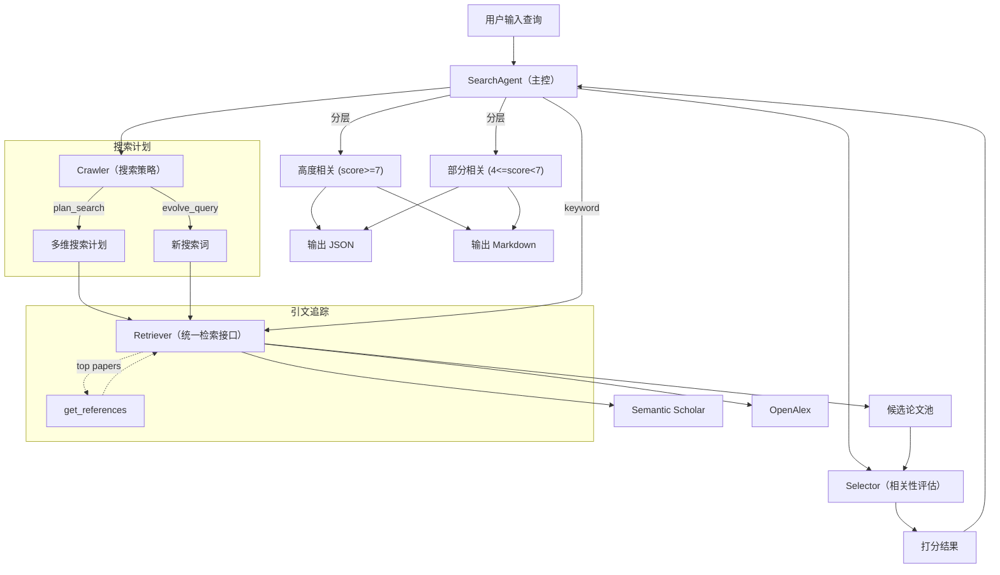

# 系统架构

## 架构图

## 模块职责

### SearchAgent (`agent.py`)
- **输入**：用户自然语言查询
- **核心功能**：编排搜索全流程（计划 → 检索 → 演化 → 追踪 → 打分 → 输出）
- **输出**：结构化结果（JSON + Markdown）

### Crawler (`crawler.py`)
- **输入**：用户查询 + 已找到论文
- **核心功能**：
  - `plan_search()`：分析查询，生成多维度搜索计划
  - `evolve_query()`：基于已找到论文生成新搜索词
- **角色**：学术搜索策略师，temperature=0.2/0.3

### Selector (`selector.py`)
- **输入**：用户查询 + 候选论文列表
- **核心功能**：`score_batch()` 批量打分 0-10，精排
- **角色**：学术相关性评估师，temperature=0.1

### Retriever (`retrieval/retriever.py`)
- **输入**：搜索查询
- **核心功能**：统一检索接口（Semantic Scholar + OpenAlex），自动去重
- **输出**：结构化论文列表

### Citation (`retrieval/citation.py`)
- **输入**：论文 ID
- **核心功能**：引文追踪（顺藤摸瓜找参考文献）
- **输出**：参考文献列表

### Parser (`query/parser.py`)
- **输入**：用户自然语言
- **输出**：结构化查询（主题、子查询、关键词、约束）

### Formatter (`presentation/formatter.py`)
- **输入**：搜索结果 dict
- **输出**：Markdown 报告 + JSON 持久化

### Settings (`config.py`)
- pydantic-settings 管理配置
- 敏感信息从 `.env` 读取，不硬编码
